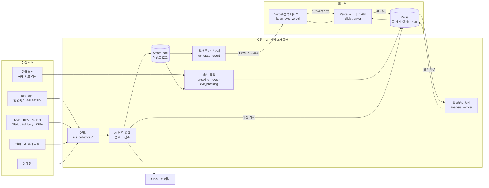
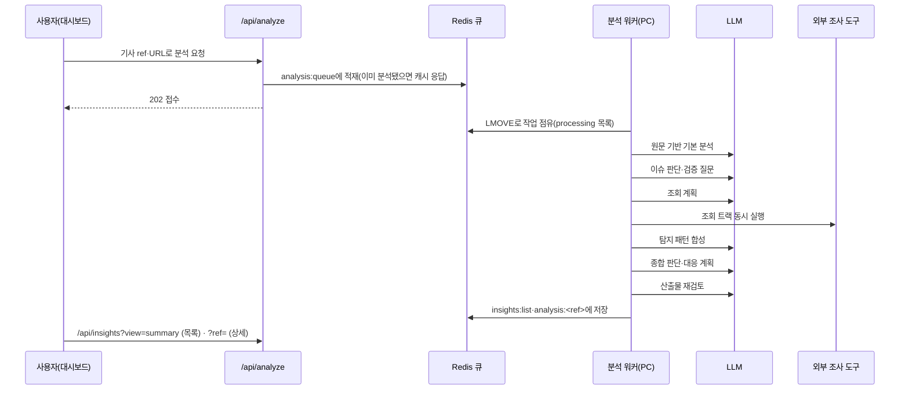

# 보안 인텔리전스 파이프라인 — 구조와 동작

보안 뉴스·취약점 공지·위협 채널을 자동으로 모으고, AI로 분류·요약·심층분석해서 알림과 공개
대시보드로 내보내는 시스템이다. 이 문서는 전체 구성과 각 단계의 동작 원리, 설계 판단의 이유, 그리고
2026년 11월에 진행한 개선 작업을 정리한다.

- 공개 대시보드: <https://boannews-vercel.vercel.app/#latest>
- 저장소 두 개로 나뉜다.
  - `security_news` (이 저장소, 공개): 수집·분류·보고서·심층분석·대시보드 데이터 생성
  - `boannews_vercel` (비공개): 정적 대시보드와 서버리스 API(`click-tracker`)

> 공개 문서라서 내부 자산 목록, 조직 우선순위(PIR) 내용, 접속 정보는 적지 않는다. 그런 정보가
> 쓰이는 자리는 "내부 전용"이라고만 표시한다.

---

## 1. 한눈에 보기

| 항목 | 내용 |
|---|---|
| 수집 소스 | RSS 50여 개(언론·벤더 연구 블로그·PSIRT·ZDI), NVD·CISA KEV·MSRC·GitHub Advisory, KISA, 국내 보안 매체, 텔레그램 공개 채널, X 계정, 구글 뉴스 국내 사고 검색 |
| 처리량 | 최근 14일 기준 약 7,700건 수집(뉴스 약 1,500건, 하루 약 110건) |
| AI | NVIDIA NIM (`nemotron-3-ultra`) 기본, 실패 시 로컬 Ollama(`qwen3:8b`)로 넘어감 |
| 출력 | Slack·이메일 알림, 일간·주간 보고서, 실시간 최신 기사·속보, 기사별 심층분석, 공개 대시보드 |
| 실행 환경 | Windows PC의 작업 스케줄러(수집·분석 워커), Vercel(정적 대시보드 + 서버리스 API), Redis(큐·캐시·실시간 피드) |
| 규모 | Python 모듈 97개, 테스트 약 640개(수집기) + 약 145개(대시보드·API), GitHub Actions CI(Ruff·Pytest·CodeQL) |

---

## 2. 기술 스택

| 영역 | 기술 | 쓰는 이유 |
|---|---|---|
| 수집·처리 | Python 3.11, `requests`, `BeautifulSoup`/`lxml` | RSS·HTML 파싱, 외부 API 호출 |
| 브라우저 자동화 | Playwright(Chromium) | 로그인이 필요한 X 게시물 URL 수집, 격리 브라우저 조사(선택) |
| AI | NVIDIA NIM API(OpenAI 호환), Ollama | 분류·요약·심층분석. 키 없는 환경·장애 시 로컬 모델로 대체 |
| 저장소 | JSON Lines(`data/events.jsonl`), JSON 상태 파일, Redis | 추가만 하는 이벤트 로그 + 서비스 간 공유 상태 |
| 웹 | 정적 HTML/CSS/JavaScript(프레임워크 없음), Lucide 아이콘 | 배포·캐시가 단순하고 빌드 단계가 없다 |
| 서버리스 | Vercel Functions(Node.js, `ioredis`) | 대시보드가 쓰는 API(심층분석 요청, 인사이트, 최신 기사, 속보, 클릭·검색 로그) |
| 운영 | Windows 작업 스케줄러, `.bat` 래퍼, Git | 5분~하루 주기 작업, 30분마다 운영 폴더를 `main`으로 맞춤 |
| 품질 | Pytest, Node test runner, Ruff, CodeQL, Dependabot | PR마다 자동 검사 |
| 외부 조사 도구 | VirusTotal, urlscan.io, abuse.ch(URLhaus·ThreatFox), OTX, Shodan, NVD·KEV·EPSS, Triage·MalwareBazaar, Google CSE/Brave | 심층분석의 근거 수집 |

---

## 3. 실행 환경과 배포

### 3.1 두 저장소, 세 실행 위치

| 위치 | 무엇이 도는가 | 배포 방법 |
|---|---|---|
| 수집 PC(Windows) | 수집기, 알림, 보고서 생성, 심층분석 워커, 속보 묶음 | 작업 스케줄러. 운영 폴더는 30분마다 `main`을 fast-forward로 받는다(`tasks/update_code.bat`) |
| Vercel `boannews-vercel` | 정적 대시보드(`dashboard/`) | `boannews_vercel` 저장소에 푸시하면 자동 배포 |
| Vercel `click-tracker` | 서버리스 API(`click-tracker/api/*.js`) | 같은 저장소, 별도 프로젝트로 자동 배포 |

작업은 개발용 클론에서 브랜치 → PR → CI 통과 → 병합 → 운영 폴더 `git pull` 순서로 반영한다.
운영 폴더에서는 직접 고치지 않는다.

### 3.2 예약 작업

| 작업 | 주기 | 하는 일 |
|---|---|---|
| `rss_collector5MinMailer` | 5분 | RSS 수집 → AI 분류 → 알림. 국내 속보·취약점 속보·이미지 보강도 이 회차에서 갱신 |
| `BoanNews5MinMailer`, `Kisa5MinMailer`, `Cve5MinMailer`, `MicrosoftPatch5MinMailer` | 5분 | 보안뉴스·KISA·NVD/KEV·MS 패치 수집과 알림 |
| `GithubAdvisoryMailer` | 1시간 | GitHub 보안 권고 |
| `analysis_worker` | 10분 | 대시보드에서 요청한 심층분석 처리 |
| `publish_trending` | 30분 | 화제 키워드 집계 → Redis, 이어서 코드 자동 갱신 |
| `publish_x_posts`, `publish_telegram_posts` | 2시간 | X 게시물 URL, 텔레그램 공개 채널 게시물 수집·게시 |
| `curator_digestMailer` | 4시간 | 최근 수집분에서 "읽을 만한 것"만 골라 요약 알림 |
| `daily_report` | 매일 | 일간 보고서, 작업 상태 점검, AI Discovery |
| `weekly_report` | 매주 | 주간 보고서 |
| `slack_feedback` | 매일 | Slack 반응·클릭·검색 로그·KEV 사후 등재를 피드백 라벨로 수집 |

---

## 4. 데이터 흐름 상세

### 4.1 수집

- **RSS(`rss_collector.py`)**: `assets/feeds.json`에 소스를 선언한다. 소스마다 신뢰도(A/B/C),
  본문 수집 여부, 회차당 최대 건수, 최대 나이, 제외 제목 패턴 등을 둔다.
  - 이미 처리한 기사는 `guid`와 `link` 둘 다로 판정한다(피드마다 어느 쪽이 안정적인지 다르다).
  - 오래된 글을 아카이브째 들고 있는 피드가 있어서, 신규 판정 전에 나이로 자른다.
  - 피드 상태(`feed_health.py`)를 기록해, 연속 실패가 시작될 때 한 번만 알린다.
- **취약점·공지**: NVD(수정 이력은 새 이벤트로 세지 않음), CISA KEV, MSRC, GitHub Advisory, 벤더 PSIRT(Cisco·Fortinet·Palo Alto·Ivanti), ZDI 공개 권고.
  - 이 소스들은 `NON_NEWS_SOURCES`로 묶어 최신 기사 목록에서는 빼고 CVE 화면에서 쓴다.
- **텔레그램(`collect_telegram_posts.py`)**: 랜섬웨어·유출 주장 채널의 공개 웹 미리보기(`t.me/s/…`)만 읽는다.
- **X(`collect_x_post_urls.py`)**: 로그인된 로컬 Chromium 프로필로 지정 계정의 최신 게시물 URL만 모은다.
  - 화면에서는 X 공식 임베드로 보여 준다.
  - 창이 화면에 뜨지 않게 화면 밖에 띄운다.
- **국내 사고 속보(`breaking_news.py`)**: 구글 뉴스 검색 RSS로 국내 언론 전체에서 사고 보도를 찾는다.
  - 같은 사고를 다룬 매체 수를 긴급도로 쓴다.
  - 실측 사례에서 보안 전문지만 볼 때보다 1시간 반가량 빨리 알 수 있었다.
- **BleepingComputer**: 사이트가 비브라우저 요청을 막는다.
  - 차단을 우회하지 않고, 구글 뉴스의 공개 사이트 RSS로 제목·링크만 받는다.

### 4.2 분류·요약(enrichment)과 중요도

기사마다 AI에게 JSON 하나를 받는다. 받는 필드는 다음과 같다.

- 요약
- 심각도
- 분류(취약점·악성코드·침해사고·…)
- 영향 제품·버전
- 공격 그룹·악성코드
- ATT&CK 기법
- 악용 상태(active·poc·none)
- 패치 여부
- 신규성
- 기사 깊이
- 분석가 관점 점수(기술 깊이·실행 가능성·신뢰도)
- 확신도

그 결과로 **규칙 기반 중요도 점수**를 낸다(`common_utils.importance_features`). 점수에 들어가는 요소는 다음과 같다.

- 심각도·악용 상태·관련성
- CVE·공격 그룹 유무
- 교차 보도 수
- 소스 신뢰도 배수(A/B/C)
- AI 확신도

피드백 라벨(Slack 반응, 링크 클릭, KEV 사후 등재)로 가중치를 학습할 수 있다(`train_weights.py`).
점수의 근거는 사람이 읽을 수 있는 문장 목록으로 함께 남는다.

> 내부 전용: 자산 인벤토리와 조직 우선순위(PIR) 매칭은 알림 판단에만 쓰고, 공개 대시보드
> 데이터에서는 뺀다(`publish_web_dashboard` 테스트가 이를 확인한다).

### 4.3 알림

- 소스별 Slack 웹훅과 이메일로 보낸다. 이메일은 한 회차의 모든 피드를 한 통으로 묶어 발송 한도를 지킨다.
- `curator_digest.py`는 3~4시간마다 "읽을 만한 것"만 짧게 다시 보낸다.
- 알림 링크는 `click-tracker`의 `/api/click`을 거쳐 원문으로 이동한다.
  - 거치는 동안 클릭을 기록하고, 이 기록이 유용성 피드백으로 돌아온다.

### 4.4 일간·주간 보고서

1. `generate_report.py`가 이벤트 로그를 기간으로 자른다. 일간은 전날 08:00부터 당일 08:00(KST)까지다.
2. 중복 CVE·동일 사건을 묶는다.
3. 국내·해외 하이라이트, CVE 카드, 공격 동향, 통계를 만든다.
4. AI가 한국어 총평을 쓴다. 형식은 `[총평]`, `[핵심 위협 TOP 3]`, `[권고 조치]`로 고정한다.
5. `publish_web_dashboard.py`가 공개용으로 정리한 JSON을 대시보드 저장소에 커밋·푸시하면, Vercel이 자동 배포한다.
   - 이때 검색 색인, 공격 동향, 위협·CVE 집계, GitHub 권고 스냅샷, 행사 일정, 사고 아카이브도 함께 만든다.
6. `check_dashboard_quality.py`(읽기 전용, 네트워크·모델 호출 없음)로 게시 데이터를 점검한다.

### 4.5 실시간 피드(대시보드 재배포 없이 갱신)

보고서 JSON은 하루 한 번 바뀌지만 최신 기사는 분 단위로 바뀐다. 커밋으로 갱신하면 배포가 너무 많이
생겨서, 실시간 데이터는 Redis를 거친다.

| Redis 키 | 쓰는 쪽 | 읽는 API | 화면 |
|---|---|---|---|
| `news:index`, `news:item:<ref>` | `live_news.py`(수집 회차마다) | `/api/news` | 최신 기사 목록 |
| `news:breaking` | `breaking_news.py` | `/api/breaking` | 지금 보도되는 국내 보안 사고 |
| `news:cve-breaking` | `cve_breaking.py` | `/api/breaking`(같은 응답) | 지금 대응할 취약점 |
| `trending:titles` | `publish_trending_titles.py` | `/api/trending` | 화제 키워드 |

API는 필요한 필드만 남겨 돌려주고(공개 엔드포인트), 짧은 인스턴스·CDN 캐시를 둔다.

### 4.6 "지금 대응할 취약점" 속보 (`cve_breaking.py`)

이미 수집한 기사만 읽고 모델·외부 호출 없이, 최신 기사 탭 맨 위에 띄울 취약점을 고른다.

**올리는 신호** (하나만 걸려도 첫 기사로 올림)

1. **이름 붙은 취약점**: `○○2Shell`, `○○4Shell`, `○○2Root` 등.
   - 원격 실행·인증 우회 맥락이 있어야 한다.
   - 이름이 제목에 있거나, 제목이 취약점 소식이어야 한다.
2. **국내 매체의 [긴급]·[속보] 취약점 기사**
3. **CISA KEV 신규 등재**
4. **24시간 안에 3곳 이상 보도**
   - 치명적이거나 악용 중으로 판정된 경우만 센다.
   - 정기 "보안 업데이트 권고"를 옮겨 실은 기사는 세지 않는다.

**묶기**: 한 기사에 함께 나온 이름·CVE를 같은 사건으로 보고 합친다(union-find).

- 비교 기사("PHP2Shell 이어 Node2Shell")는 주된 이름 하나로만 묶는다.
- CVE를 4개 이상 나열한 요약 기사는 연결 고리로 쓰지 않는다.

**왜 이렇게 했나**: 지난 30일을 1시간 간격으로 재현해 기준을 정했다.

- PHP2Shell·Node2Shell·Java4Shell·NGINX2Root는 하나도 KEV에 오르지 않았다.
- 세 번째 매체가 보도하기까지 2~16시간이 걸렸다.
- 이름·[긴급] 신호를 더하자 첫 보도 후 0.5~1.5시간 안에 올라왔다.
- 30일간 카드는 46개로, 하루 약 1.5개였다.

### 4.7 심층분석 파이프라인

대시보드에서 기사의 "심층분석"을 누르면 돌아가는, 이 시스템에서 가장 큰 기능이다.

**왜 PC 워커인가**: 처음에는 Vercel 함수가 직접 분석했다. 그런데 쓸 수 있는 모델이 모두 Vercel의
60초 제한을 넘겨서, API는 큐에 넣기만 하고 시간 제한이 없는 PC 워커가 처리하게 바꿨다.

- 작업 점유는 `LMOVE`(queue → processing)로 한다. 실패하면 지연 재시도 목록으로 옮긴다.
- 단계별 중간 결과는 체크포인트(`worker_progress`)로 남겨, 재시도 때 끝난 단계를 다시 하지 않는다.

**단계**(화면의 "분석 경로" 탭과 같은 순서)

| 단계 | 모듈 | 하는 일 |
|---|---|---|
| 1. 원문 확보 | `analysis_worker` | 기사 본문을 받는다. 접근이 막히면 기사가 인용한 1차 연구 자료를 대신 쓴다 |
| 2. 기본 분석 | `analysis_worker` + LLM | 핵심 요약, 기술적 세부 단계, ATT&CK, 영향, 권장 대응, 흐름도 데이터, 조사 대상 |
| 3. 관찰 항목 | `artifact_extractor`, `source_evidence` | 정규식 + LLM으로 IOC를 뽑고 원문 문맥과 대조한다. 정상 인프라는 "차단 금지"로 가른다 |
| 4. 유형 분류 | `article_kind` | 공격 사건인지 정보성 기사인지 가른다. 정보성이면 `briefing`의 배경 정리 경로로 간다 |
| 5. 이슈 판단 | `issue_decision` | 사건별 이슈, 조사 여부, **공개 자료로 답할 검증 질문**, **사내 확인 항목**, 달성 기준을 정한다 |
| 6. 조회 설계 | `lookup_plan` | 목표·질문을 보고 조회 트랙과 대표 샘플을 고른다 |
| 7. 자료 조회 | `investigation.run_lookups` | 트랙을 동시에 실행: VT 동적 분석, 교차 인텔, URL 분석, 취약점(NVD·KEV·EPSS), 공급망, 확장 프로그램, GitHub, 연구 자료 검색 |
| 8. 목표 검증 | `goal_evidence`, `research_actions` | 질문별로 필요한 근거가 있는지 보고, 모자라면 다음 조사를 고른다 |
| 9. 추가 조사 | `investigation._run_followups` | 판단이 요청한 값을 이미 가진 도구로 한 바퀴 더 조회한다(라운드 상한) |
| 10. 종합 판단 | `response_synth` | 확인·미확인·모순, 질문별 판정, 노출 대상, 대응 계획을 낸다. 근거 없는 값은 가린다 |
| 11. 대응 산출물 | `response_builder`, `pattern_synth`, `output_critic` | 차단·확인 목록, MDE KQL 헌팅 쿼리, urlscan·VT·검색 패턴, 산출물 재검토 |
| 12. 점검 | `playbook`, `analyst_workflow` | 선언한 달성 기준 대비 산출물을 "달성·미달·해당 없음"으로 판정한다 |

**부가 산출물**

- `analysis_flow`: 원문 인용이 확인된 단계·연결만으로 공격 흐름도를 그린다. 이미지 모델은 쓰지 않는다.
- `analysis_trace`: 실제로 실행된 호출·조회·시간을 기록한다. 모델의 생각은 기록하지 않는다.
- PDF 보고서
- 여러 사건을 다룬 기사(`incident_scope`)는 사건별로 따로 조사한 뒤 같은 형식으로 합친다.

### 4.8 AI Discovery (`threat_discovery.py`)

수집된 기사 전체에서 새 위협 후보를 찾는다.

1. 가설
2. 근거 확인
3. 반대 검토
4. 확정

이 단계를 거친 것만 공개한다. 판정이 낮아지면 그 이유를 함께 싣는다.

### 4.9 대시보드와 API

**대시보드**(정적 사이트, `dashboard/`)

| 탭 | 내용 |
|---|---|
| 대시보드 | 위협·CVE·수집 상태 시각화, 보안 생태계 지도 |
| 최신 기사 | 상단부터 다음 순서로 보인다 |
| 위협 요약 | 일간·주간 보고서 |
| CVE | 취약점 카드, GitHub 권고 |
| 인사이트 | 심층분석 결과 |
| 사고 아카이브 | 검토된 사고 기록 |
| 히스토리 | 지난 보고서 |
| AI Discovery | 새 위협 후보 |

최신 기사 탭 상단 순서:

1. 지금 대응할 취약점
2. 국내 보안 사고
3. 추천
4. 주제·출처별 줄: 제목의 단어를 눌러 고른다

화면 공통 요소:

- 상단 버튼: X·텔레그램 드로어, 인사이트 드로어, 행사 일정, 검색
- 패널은 바깥을 누르면 닫힌다.

**API**(`click-tracker/api`)

| 엔드포인트 | 역할 |
|---|---|
| `analyze.js` | 심층분석 요청 접수(캐시·속도 제한·큐 적재) |
| `insights.js` | 인사이트 목록(`?view=summary`, 압축)과 상세 1건(`?ref=`), 진행 중 분석(`?pending=1`) |
| `news.js` | 최신 기사 |
| `breaking.js` | 국내 사고 속보 + 취약점 속보 |
| `trending.js` | 화제 키워드 |
| `click.js`, `search-log.js` | 클릭·검색어 기록(피드백 수집용) |
| `report-summary.js` | 보고서 요약 보조 |

---

## 5. 설계 원칙

1. **근거 없는 값은 내보내지 않는다.**
   - AI가 쓴 도메인·IP·해시·CVE는 조회 재료와 원문에 실제로 있어야 남는다.
   - 흐름도 단계와 이슈 근거는 원문 인용이 확인돼야 한다.
   - 하나가 틀렸다고 전체를 버리지 않는다. 틀린 값만 빼거나 가리고, 뺀 개수를 함께 표시한다.
2. **모델의 자기 평가를 믿지 않고 코드로 확인한다.**
   - "무엇을 내야 하나"(달성 기준)는 모델이 선언한다.
   - "냈나"는 코드가 판정한다(`playbook`).
   - 입력이 없어 낼 수 없던 것은 "미달"이 아니라 "해당 없음"이다.
3. **공개와 내부를 나눈다.** 자산·우선순위·내부 판단은 공개 데이터와 화면에서 빼고, 테스트로 고정한다.
4. **비용과 시간을 통제한다.**
   - 같은 기사는 캐시하고, 공개 엔드포인트에는 속도 제한을 둔다.
   - 제한 시간을 다 쓰고 끊긴 AI 호출은 다시 보내지 않는다. 대체 경로가 있는 단계만 해당한다.
   - 서로 다른 API를 쓰는 조회는 동시에 돌린다.
5. **화면 갱신과 배포를 분리한다.** 분 단위로 바뀌는 데이터는 Redis와 API로 보내고, 정적 사이트 재배포는 하루 단위 보고서에만 쓴다.
6. **실패를 숨기지 않는다.**
   - 조회 실패, 판정 누락, 검토 필요 사유를 화면과 기록에 남긴다.
   - "결과 없음"과 "실행 안 함"을 구분한다.
7. **사이트의 차단 정책을 우회하지 않는다.** 막힌 소스는 공개 집계 피드로 대체하거나 끈다.

---

## 6. 품질 관리

- **자동 검사**: PR마다 GitHub Actions에서 Ruff, Pytest(약 640개), CodeQL을 돌린다. 대시보드는 Node 테스트(약 145개)를 쓴다.
- **오프라인 점검**: `check_dashboard_quality.py`, `check_analysis_quality.py`, `analysis_evaluation.py`. 모두 모델·네트워크 호출 없이 저장된 결과를 검사한다.
- **재현 검증**: 기준을 바꿀 때는 저장된 실제 기록이나 지난 기간 데이터로 먼저 돌려 본다.
  - 저장된 Gootloader 분석을 새 판단 규칙으로 다시 판정했다.
  - 30일 이벤트로 속보 기준을 재현했다.
- **실행 기록**: 심층분석마다 `execution_trace`가 남는다. 단계별 소요 시간과 실패 원인을 이것으로 찾는다.
- **실제 화면 확인**: 대시보드 변경은 배포 후 실제 사이트에서 동작·콘솔 오류를 확인한다.

---

## 7. 2026년 11월 개선 작업

문제를 실측으로 확인하고, 고치고, 다시 측정하는 순서로 진행했다. 괄호는 PR 번호다
(`S` = security_news, `V` = boannews_vercel).

### 7.1 수집 채널

| 작업 | 내용 |
|---|---|
| X 패널 (S#13~17, V#4·5) | Playwright로 계정을 돌며 게시물 URL을 모으는 방식을 유지했다. 갱신 실패를 알리고, 바뀐 게 없으면 커밋하지 않으며, 브라우저 창이 뜨지 않게 했다. 패널은 계정별로 골라 보게 했다 |
| 텔레그램 (S#18·19, V#7) | 랜섬웨어·유출 주장 채널(Ransomlook, DARKFEED 등)을 수집하고, 텔레그램 채널처럼 보이는 드로어를 만들었다 |
| 소스 정비 (S#36·37) | BleepingComputer를 공개 집계 RSS로 복구했다. 고장 난 피드(잉카인터넷·Reddit)는 사유와 함께 껐다. watchTowr·Horizon3·ZDI·Ivanti PSIRT를 추가했다 |
| GitHub 권고 (S#26, V#14) | CVE 탭에 최근 GitHub 보안 권고를 실었다 |

### 7.2 대시보드

| 작업 | 내용 |
|---|---|
| 개요 재구성 (S#12·20, V#1~3·8~12) | 예시 데이터를 걷어내고 실제 수집 데이터로 위협·CVE·수집 상태를 시각화했다. 일간·주간 탭을 합치고 CVE 중복을 없앴다. 보안 생태계 지도를 IT 영역별 레인으로 배치하고 관계를 보이게 했다 |
| AI Discovery (S#21·24·25, V#13) | 가설→근거→검토→확정 단계로 새 위협을 찾는 탭을 만들었다 |
| 인사이트 목록 분리 (V#15) | 목록 요청이 8.6MB(압축 후 1MB, 3.4초)였다. 요약 목록 44KB와 상세 1건 즉시 조회로 나눴다 |
| 바깥 클릭 닫기 (V#21) | 필터·X·텔레그램·인사이트 패널을 바깥을 눌러 닫게 했다 |
| 취약점 속보 (S#38, V#22~25) | 최신 기사 맨 위에 "지금 대응할 취약점"을 추가했다(4.6절). 국내 사고 줄의 카드 크기와 제목 크기를 다른 줄과 맞췄다 |
| 주제·출처 고르기 (V#26) | "이번에 볼 주제 · 침해사고 ▾"처럼 제목의 단어를 눌러 고르게 했다. 처음 값은 무작위를 유지했다 |

### 7.3 보고서·운영

| 작업 | 내용 |
|---|---|
| 일간 보고서 기간 (S#22) | 보고서가 전날까지만 다뤘다. 마감 시각을 08:00 KST로 맞추고, 기간이 늦으면 경고하게 했다 |
| 작업 상태 점검 (S#23) | 예약 작업 상태를 실행 로그로 판정하게 했다. Slack이 실패하면 이메일로 대체한다 |

### 7.4 심층분석 품질

최근 인사이트 4건을 분석 경로대로 원본 데이터까지 검토해서 나온 문제를 차례로 고쳤다.

| 문제(실측) | 수정 |
|---|---|
| 기사와 무관한 2018~2019년 CVE 3건이 "패치 대상"과 "예외 처리로 먼저 올린다"는 지시에 들어갔다. 한 사건의 "차단 금지" 해시가 다른 사건의 "차단 후보"에 있었다. MD5가 SHA-256 목록에 섞였다 (S#27) | 기사 대상 CVE만 대응에 쓰고 나머지는 "참고"로 분리했다. 차단 금지 값을 차단 목록에서 뺐다. 해시를 길이로 구분하고 중복을 없앴다 |
| 검증 질문 19개 중 확인 0개. 9개가 사내 로그로만 답할 수 있는 질문이었다 (S#28, V#16) | 검증 질문은 공개 자료로 답할 것만 남겼다. 사내 확인 항목은 따로 기록하고 표시한다 |
| 흐름도 데이터가 있는 27건 중 3건만 표시됐다 (S#29, V#17) | 단계·연결을 하나씩 원문과 대조해, 틀린 것만 빼고 그린다. 절반 미만만 확인되면 생략한다 |
| 여러 사건 기사의 기록 형식이 달라 관측 결과·PDF가 비었다 (S#29) | 사건별 결과를 단일 사건과 같은 최상위 형식으로 합쳤다 |
| 분석 1건 중앙값 16분, 최대 57분. 실패한 AI 호출을 같은 조건으로 재시도해 기다린 시간이 13건 합계 97분이었다. 그 재시도는 8번 모두 실패했다 (S#30·31) | 제한 시간을 다 쓰고 끊긴 호출은 재시도하지 않는다. 서로 다른 API를 쓰는 조회는 동시에 돌린다. Gootloader 분석이 30분에서 약 9분으로 줄었다 |
| 질문이 있는 분석 61건 중 26건(43%)에서 질문별 판정이 전부 버려졌다. 질문 문장을 한 글자도 다르지 않게 옮겨야 받는 코드였다 (S#32, V#18) | 질문을 Q1·Q2 번호로 주고받는다. 판정이 빠진 질문은 "판정 누락"으로 표시한다 |
| 판단이 다루지 않은 단계가 같은 문장 그대로 이슈·질문·사내 확인으로 반복됐다. 피해 통계와 수사기관 압수에도 "로그 확인"이 붙었다 (S#33, V#19) | 모든 단계를 배정하게 하고, 공격이 아닌 사실은 "확인된 사실"로 두게 했다. 빠진 단계는 한 줄로만 알린다 |
| 근거 없는 값 하나 때문에 대응 계획이 0개가 됐다. 입력이 없어 낼 수 없는 기준이 "미달"로 찍혔다 (S#34, V#20) | 원문에 이름으로 나온 서비스는 근거로 인정한다. 근거 없는 값은 가리고 조치는 남긴다. 낼 수 없는 기준은 "해당 없음"으로 분리했다 |
| 떨어진 두 문장을 이어 붙인 근거가 "검토 필요"로 걸렸다. 실행하지 않은 브라우저 조사가 실패로 집계됐다 (S#35) | 근거를 문장 단위로 대조한다. 실행하지 않은 조사는 "입력 없음"으로 분류한다 |

**같은 기사(Gootloader) 재분석 비교**

| 항목 | 개선 전 | 개선 후 |
|---|---|---|
| 분석 시간 | 30분 | 9분 |
| 이슈 | 기본 분석 단계를 그대로 옮긴 이슈 5개 | AI가 정리한 이슈 7개. 공격이 아닌 사실은 "확인된 사실" |
| 질문별 판정 | 0개 | 5개 모두 근거 인용과 함께 판정 |
| 대응 계획 | 0단계 | 5단계 |
| 산출물 점검 | 9개 중 4개 미달 | 달성 3, 해당 없음 3, 미달 1 |

---

## 8. 한계와 다음 과제

- **분석 시간**: 대부분 순차 AI 호출(5~6회, 회당 30초~3분) 시간이다. 단계끼리 결과를 이어받아 병렬화할 수 없다. 더 줄이려면 일부 단계의 모델이나 출력 길이를 바꿔야 하는데, 이는 품질과 맞바꾸는 결정이다.
- **같은 기사 묶기**: 최신 기사 목록은 아직 같은 사건의 기사를 묶지 않는다. 기사 3건 이상에서 다뤄진 CVE가 2주에 132개였다.
- **KEV 대조 시점**: KEV 등재는 수집 시점에만 대조한다. 나중에 등재된 CVE의 기사에는 표시가 붙지 않는다.
- **피드 부재**: SonicWall·Citrix는 공개 RSS가 없어 KEV·NVD로만 받는다.
- **속보 카드 중복**: 이름 붙은 취약점 기사 제목에 CVE가 없으면, 같은 건의 CVE 기사가 별도 카드로 뜰 수 있다.

---

## 9. 용어

| 용어 | 뜻 |
|---|---|
| KEV | CISA Known Exploited Vulnerabilities, 실제 악용이 확인된 취약점 목록 |
| EPSS | 향후 30일 안에 악용될 확률 추정치 |
| IOC | 침해 지표(도메인·IP·URL·해시 등) |
| PSIRT | 벤더의 제품 보안 사고 대응팀(보안 권고 발행처) |
| MDE KQL | Microsoft Defender for Endpoint 고급 헌팅 쿼리 언어 |
| PIR | 조직의 우선 정보 요구사항(내부 전용) |
| 1차 자료 | 기사가 인용한 원 연구·공지 문서 |
